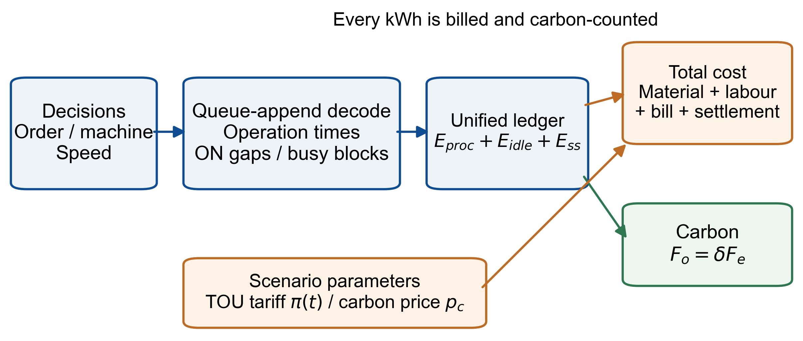
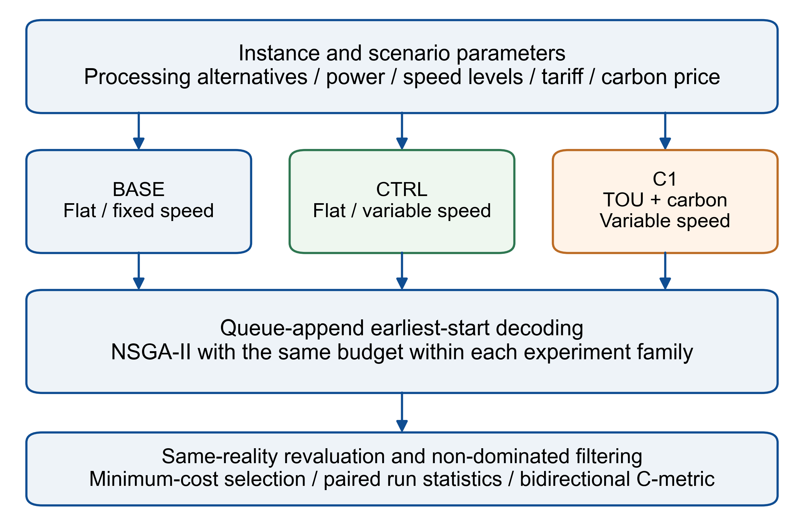
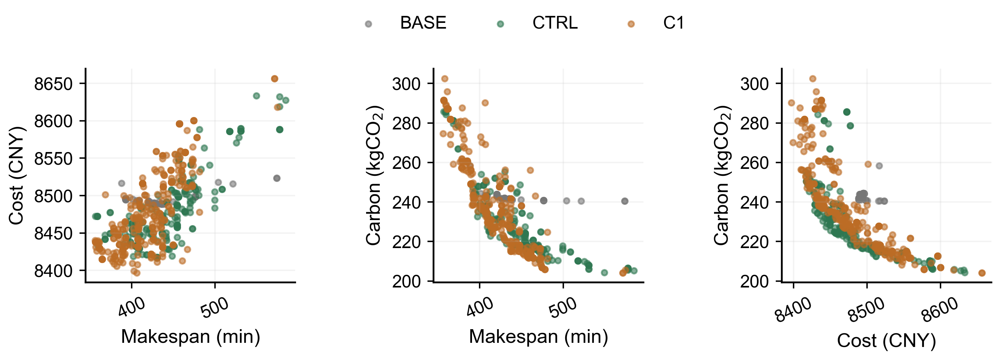
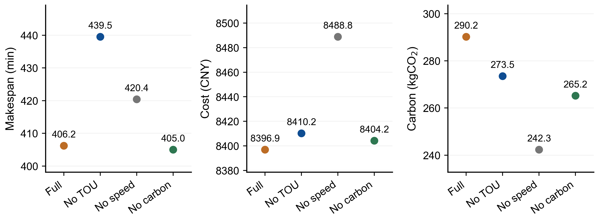
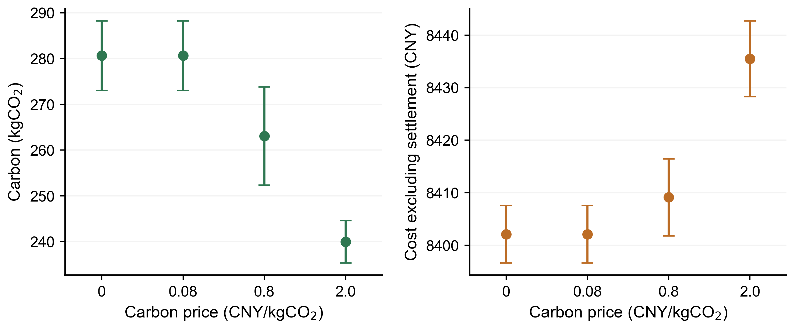
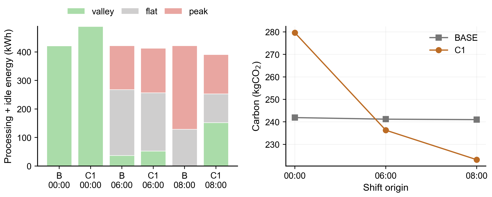
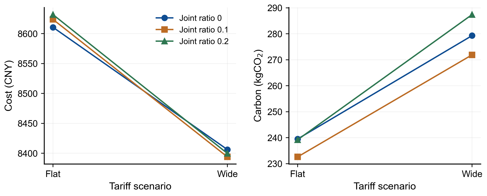

> 本文件由对应 Word 文档提取，便于检索与审查；公式、排版及正式文稿以同名 DOCX 为准。

耦合分时电价、变速选择与线性碳结算的柔性作业车间调度：三目标优化与价格碳权衡的情景依赖性

作者一（First Author）¹　作者二（Second Author）²\*

¹ 单位一，城市 邮编；² 单位二，城市 邮编

\* 通讯作者（E-mail：待补充）

摘要

柔性作业车间的排序、机床指派与速度选择共同影响加工时刻、用电费用和碳排放。针对不同规划规则因计价假设和能耗边界不同而难以直接比较的问题，本文建立统一能源账本下的三目标调度模型，对加工、待机与启停电量一致计费计碳，并耦合分时电价、离散变速与线性碳结算。采用共同求解配置和现实成本最小选点规则，设置价格盲目但速度可见的对照，分别评价速度可用性及分时与碳结算联合感知的增量。齿轮轴案例中，整合规则相对平价基线每运行降低成本77.7±13.6元、缩短完工32.3±15.3 min，同时增加碳排33.3±14.4 kgCO₂；重评价并集前沿的双向覆盖率为1.000与0.000。由已归档四档碳价搜索班表构建的运行内公共池，在0与0.08元/kgCO₂下选点相同，在0.8与2.0档观察到平均排放下降。起点移位与待机、启停能耗的联合参数实验表明，所测情景中的成本排放权衡可随实例和参数改变方向；齿轮轴在联合归零后仍存在增碳现象，排除了全待机解释。线性对称结算下，配额水平仅平移成本常数，不改变调度排序。结果量化了联合规划规则的收益及碳代价，并为指定解码空间与搜索预算下的价格响应提供了可复核证据。

**关键词：柔性作业车间调度；低碳制造；分时电价；线性碳结算；机床变速；统一能源账本；价格碳权衡**

1　引言

生产调度决定制造用电在何时、何地以及以何种强度被消耗，因此同时影响生产成本与碳足迹。柔性作业车间中，每道工序可在候选机床集中选择设备，加工速度又进一步改变工序时长与功率。将工序排序、机床指派和加工强度联合优化，是研究制造效率与低碳目标之间关系的重要途径[13]。

低碳柔性车间调度研究可按所嵌入的经济机制分为三类。第一类在时间目标上叠加由恒定功率与固定排放因子计算的能耗或碳排项，代表工作包括Mei等[1]的改进NSGA-II三目标模型、Liao与Qian[2]的碳足迹驱动模型，以及Destouet等[3]的可持续调度模型。第二类引入动态或分时电价，研究能源与劳务目标[4]、客户满意度[5]以及离散速度选择[6]。第三类引入碳成本或能源市场机制，包括配额交易与外包策略[7]、生产调度与能源采购的两层耦合[8]；相关研究也采用深度强化学习处理可再生供给下的低碳调度[9]和扰动重调度[10]。表1比较上述近邻研究的机制特征。在所比较文献中，分时电价、速度相关功率与碳结算尚未在本文采用的统一评价框架中共同处理，待机与启停状态的披露口径也不尽相同。表中“未报告”表示原文没有披露相应边界或状态定义，不代表确定缺失。为比较不同规划规则的实际价值，还需要在共同电价、结算与能耗账本下重新评价其班表，并将模型规则、求解配置和取点方式分别说明。

本文建立耦合分时电价、离散速度与线性碳结算的三目标柔性作业车间调度模型，以统一能源账本连接生产决策、电费与碳排，并采用带引导初始化的NSGA-II求解。研究贡献有四方面。第一，在共同求解配置与同现实评价下量化整合规则相对平价基线的成本、完工和碳排增量，通过速度可见对照区分速度可用性与联合市场感知的运行级效果。第二，在固定运行内候选池中分析四档碳价的选点与排放响应，并给出配额常数平移的数学性质与数值校核。第三，通过班次起点移位和非加工能耗联合参数实验，给出价格碳权衡随所测情景变化的证据及反例。第四，提供班表档案、实验配置映射与离线重评价程序，使主比较、消融和共池结果能够从染色体直接复算。

表1　近邻研究与本文的机制特征比较

| **研究** | **分时计费** | **速度功率耦合** | **待机启停计费** | **碳成本机制** | **等待或时钟决策** | **统一账本** |
| --- | --- | --- | --- | --- | --- | --- |
| Mei 等[1] | 无 | 无 | 仅计碳 | 固定因子 | 无 | 否 |
| Liao 与 Qian[2] | 无 | 无 | 仅计碳 | 固定因子 | 无 | 否 |
| Gong 等[4] | 有 | 无 | 未报告 | 无 | 无 | 未报告 |
| Jia 等[5] | 有 | 无 | 未报告 | 固定因子 | 无 | 未报告 |
| Zhang 等[6] | 有 | 有 | 未报告 | 无 | 无 | 未报告 |
| Zhang 等[7] | 无 | 无 | 未报告 | 配额交易 | 无 | 未报告 |
| Burmeister 等[8] | 动态市场价 | 无 | 未报告 | 市场采购 | 无 | 未报告 |
| 本文 | 有 | 有 | 计费且计碳 | 线性对称结算 | 无（显式限定） | 是 |

图1　联合决策与统一能源账本的耦合关系。加工、内部待机空档与块起点加载瞬态的电量同时进入电费和碳排核算

2　统一能源账本下的问题描述与数学模型

2.1　机器状态与统一能源账本

每台机床具有加工、待机与关机三种状态。其首个忙碌块起点至末个忙碌块终点构成通电窗口，窗口内未被加工占用的区间为待机，按空载功率耗电；窗口外视为关机，不耗电。每个忙碌块起点计一次启停能耗，在本文中具体表示加载瞬态，而非每次均将整台机床断电重启。加工与待机电量在相应区间内按分时电价积分计费，加载瞬态电量按块起点时刻的电价计费，三项同时进入碳核算且不重复计价。固定可行的机床指派x、同机工序顺序y及速度s后，队尾追加解码递推确定各工序开工和完工时刻。机床指派决定额定加工参数，速度进一步决定实际时长与功率，二者共同作用于能源账本。

$F\_{e} = E\_{proc} + E\_{idle} + E\_{ss}$ (1)

$F\_{o} = δ · F\_{e}$ (2)

$C\_{elec} = Σ\_{m} Σ\_{windows} ∫\_{t0}^{t1} π (t) · P\_{w} dt / 60 + Σ\_{m} Σ\_{blocks} e\_{ss\\_m} · π (t\_{block)}$ (3)

式(1)的三项分别为加工、待机与加载瞬态电量，式(2)以固定电网排放因子δ折算碳排。式(3)第一项分别对加工窗口和内部待机区间积分，Pw为对应状态功率；第二项对每个忙碌块的起点计入启停电费。时间单位为min，故功率积分除以60得到kWh。图表中的峰平谷电量仅包含加工与待机，启停电量在能量分解中单列；这两部分之和等于式(1)的总电量。

表2　整合模型的主要记号

| **符号** | **含义** |
| --- | --- |
| J, i | 工件集合与工件下标 |
| *Oi*, j | 工件 i 的工序序列与工序下标 |
| M, k | 机床集合与机床下标 |
| S, s | 离散速度档 {0.8, 1.0, 1.2} 与速度下标 |
| *Tijk* | 工序 *Oij* 在机床 k 上标称速度的加工时间，min |
| *Pijk* | 工序 *Oij* 在机床 k 上的额定加工功率，kW |
| *β* | 功率速度律指数，取 2 |
| *π*(t) | 时刻 *t* 的分时电价，元/kWh |
| *wk* | 机床 k 的工资率，元/min |
| *pidle*\_k, *ess*\_k | 机床 k 的待机功率与单次启停能耗，kW 与 kWh |
| *δ* | 电网排放因子，kgCO2/kWh |
| *pc* | 碳结算价，元/kgCO2 |
| *Ecap* | 工厂碳配额，kgCO2 |
| *ci* | 工件 i 的材料成本，元 |
| *xijk* | 0-1 变量，工序 *Oij* 在机床 k 加工时为 1 |
| *yijhl* | 同机两道工序的顺序 0-1 变量 |
| *sij* | 工序 *Oij* 的速度档 |
| *Ci* | 工件 i 的完工时间，min |
| *Ft*, *Fc*, *Fo* | 目标，完工时间、总成本与碳排 |

2.2　决策变量与可行空间

决策变量为机床指派$x\_{ijk}$、同机顺序$y\_{ijhl}$与速度档$s\_{ij}$，须满足每道工序唯一机床、工件工序先后、同机不重叠及速度可行域。解码器按工序序列依次处理工序，开工时刻取其前道工序完工与所选机床队尾可用时刻的较大者，完工时刻为开工加$T\_{ijk}$/$s\_{ij}$，并据此更新机床可用时刻。该构造不向队列内部插入工序，也不增加主动等待变量，因而定义了完整分时调度可行域的一个子空间。本文的负荷时序变化均在该子空间内解释。离散速度集为{0.8, 1.0, 1.2}，用于近似有限档位控制，并假设这些档位满足所测工序的工艺要求。

图2　求解与评价流程。BASE为平价固定速度基线，CTRL为平价可变速度对照，C1为分时与碳结算联合感知模型；解码均采用队尾追加最早开工规则

2.3　三目标与市场机制

完工时间 *Ft* 为最大工件完工时间。成本目标 *Fc* 由材料成本、劳务成本、统一账本电费与碳结算项构成，见式(5)。速度选择通过功率速度律同时缩放加工时间与功率，见式(6)。碳结算为线性对称式，见式(7)。

$F\_{t} = max\_{i} C\_{i}$ (4)

$F\_{c} = Σ\_{i} c\_{i} + Σ\_{ops} w\_{k} · T\_{ij} (s) + C\_{elec} + p\_{c} · ( F\_{o} − E\_{cap} )$ (5)

$T\_{ij} (s) = T\_{ijk} / s , P\_{ij} (s) = P\_{ijk} · s^{β} , β = 2$ (6)

$settlement = p\_{c} · ( F\_{o} − E\_{cap} )$ (7)

线性对称结算有一个可直接证明的性质，固定碳价下配额 *Ecap* 只向所有班表的成本加同一常数，因而不改变任何两个班表的成本差、三目标支配关系与 Pareto 解集，配额倍率扫描因此是会计校核而非激励实验，碳价 *pc* 才是改变调度行为的边际激励，3.4 节据此组织实验。

2.4　求解方法

本文采用NSGA-II[11]作为共同求解器，初始化中快速机床、局部机床与随机机床选择的比例为0.6、0.3、0.1。三层染色体分别编码工序序列、机床候选索引与速度档，速度层使用均匀交叉和双基因变异。选择、交叉变异率与种群存活规则在比较组之间保持相同，配置及种子见补充材料。图神经网络与强化学习也已用于柔性作业车间调度[14]；本文采用固定的进化求解流程，以便在同预算下比较规划规则，而不将求解器性能突破作为研究主张。

主比较与机制消融采用每组6运行、每运行80代；独立碳价扫描与原点实验采用4运行、80代；联合非加工能耗参数实验采用3运行、80代；上述种群规模均为150。共池重评价复用独立碳价扫描的四运行前沿，并加入相同运行编号的BASE候选，不新增优化搜索。基线算法复现汇总采用20运行、100代，与市场机制实验分开报告。同预算比较限定在相应实验族内。

3　计算实验

3.1　算例、参数与评价协议

算例与参数。齿轮轴车间包含10工件和15机床，加工时间、工序机床对功率及材料成本取自文献[1]表3；基准电价0.8118元/kWh与排放因子0.5703 kgCO₂/kWh沿用其复现设置。Brandimarte Mk01至Mk10[12]不含能耗数据，采用固定的合成功率剖面。待机功率为额定功率的20%，加载瞬态能耗设为一个待机分钟的电量，工资率为0.5元/min；速度功率指数β取2。上述能耗、工资和速度参数均作为情景假设记录，齿轮轴案例使用论文报告的工业来源参数，整体研究为模拟优化。

分时曲线设为谷段00:00至07:00及21:00至24:00，峰段08:00至11:00及13:00至19:00，其余为平段，峰平谷倍率为1.6、1.0、0.4。该曲线和0.08元/kgCO₂碳价均作为示例情景，不声称等同某年目录电价或全国市场均价。碳结算用于内部碳定价模拟，不将机械加工案例认定为实际ETS履约主体，也不将外购电排放结算解释为其真实履约账单。

评价协议。主比较含平价固定速度基线BASE、平价可变速度对照CTRL，以及分时与碳结算联合感知模型C1。三组候选均在相同分时电价、排放因子、配额与碳价下重评价，并重新筛选非支配点。表3代表点为各模型六运行重评价并集前沿中的最低现实成本点；另对每个运行分别取最低成本点，以相同种子编号配对计算运行级差值。并列最低成本按档案中的源顺序确定，所有统计先用未取整值计算，最后统一显示精度。BASE的速度保持标称，CTRL相对BASE评价速度可用性，C1相对CTRL评价分时与碳结算的联合感知增量。

文中“均值±标准差”采用分母n的运行间描述性标准差，主比较n=6，共池实验n=4；误差棒同此口径。配对t的95%区间另采用分母n−1的样本标准差与n=6，按运行独立、配对差近似正态的假设描述不确定性。覆盖率C-metric报告共同现实下的运行并集前沿双向值，主口径按个体多重集计数，补充材料同时提供唯一目标点口径。退化自检检查关闭市场机制后与平价统一账本逐项一致。

3.2　统一账本下的联合决策价值

表3给出三模型代表点，图3给出重评价并集前沿。齿轮轴C1相对BASE的运行级成本差为−77.7±13.6元、完工差为−32.3±15.3 min、碳差为+33.3±14.4 kgCO₂，六个运行的成本差与碳差符号均一致。C1对BASE的前沿覆盖率为1.000，反向为0.000；Mk04对应为0.816与0.000。部分覆盖值受重复个体权重影响，去重后Mk04对应为0.744与0.000，齿轮轴仍为1.000与0.000。

沿BASE、CTRL、C1的比较链，齿轮轴CTRL减BASE平均缩短完工4.2±13.3 min、降低成本63.8±6.7元；C1减CTRL平均再缩短完工28.1±5.6 min，成本差为−13.9±14.3元，配对t 95%区间为−30.4至2.6元。因此，联合感知的降本增量在本次小样本中尚不能确认为稳定收益。Mk04两段完工均值差分别为−33.9和−3.5 min，贡献排序与齿轮轴相反。该比较链度量的是各规划规则与重优化后班表的差异，不等同于固定路由和排序后的纯速度效应。

代表点成本分解显示，齿轮轴C1的劳务项为827.8元，BASE为949.5元，而电费由139.2升至165.2元。Mk04也表现为成本和完工下降、碳排增加。本文劳务项按每道工序实际加工时长累加，并非按全车间完工时间整体计薪。可变速度通过缩短加工时长降低该成本项，同时可能提高加工能耗；路由与排序变化也影响最终账本。故应同时报告经济收益与碳代价，并结合3.4节的固定候选池分析价格响应。

表3　共同现实下的跨运行代表点。BASE、CTRL和C1定义见3.1节，逐运行配对统计另列于表后

| **算例与模型** | **完工 min** | **总成本 元** | **碳排 kgCO2** | **电费 元** | **劳务 元** |
| --- | --- | --- | --- | --- | --- |
| 齿轮轴 BASE | 437.1 | 8488.6 | 241.3 | 139.2 | 949.5 |
| 齿轮轴 CTRL | 430.0 | 8416.5 | 255.2 | 147.0 | 868.5 |
| 齿轮轴 C1 | 406.2 | 8396.9 | 290.2 | 165.2 | 827.8 |
| Mk04 BASE | 154.0 | 166.4 | 7.7 | 4.4 | 162.0 |
| Mk04 CTRL | 108.1 | 147.4 | 8.4 | 4.8 | 142.6 |
| Mk04 C1 | 105.8 | 145.1 | 8.7 | 5.0 | 140.0 |

注：代表点从六运行重评价并集前沿取最低现实成本，不能与运行级均值混用。C1减BASE的六运行配对差为：齿轮轴成本−77.7±13.6元、完工−32.3±15.3 min、碳排+33.3±14.4 kgCO₂；Mk04成本−19.8±1.5元、完工−37.5±6.8 min、碳排+0.90±0.23 kgCO₂。±为分母n的描述性标准差。齿轮轴CTRL对BASE覆盖率为0.665，C1对CTRL及其反向分别为0.273和0.353。

图3　齿轮轴三模型重评价并集前沿的三组投影。BASE、CTRL和C1定义见3.1节；坐标单位为min、元与kgCO₂

3.3　机制分解

表4和图4比较各消融变体的跨运行代表点。齿轮轴移除速度层后，完工由406.2变为420.4 min，碳排由290.2降至242.3 kgCO₂，加工电量由495.4降至422.3 kWh。相对无速度变体，完整模型的加工电量约增加17.3%，完工约缩短3.4%，显示该代表点存在加工强度与时间的交换。移除分时感知后，齿轮轴完工变为439.5 min，碳排为273.5 kgCO₂；Mk04完工则由105.8降至101.8 min，说明完工响应方向随算例而变。

移除碳结算后，齿轮轴选定点碳排为265.2 kgCO₂，与完整模型的差异同时受到有限预算搜索和选点影响，不能直接作为碳结算因果效应。表4的单个代表点与3.2节的运行级比较链分别报告，不作统一机制排序。碳价响应采用3.4节的共同候选集重计价加以分析。

表4　组件消融，齿轮轴案例，选定点的完工/总成本/碳排与加工/待机/启停电量分解

| **变体** | **完工 min** | **总成本 元** | **碳排 kgCO2** | **加工 kWh** | **待机 kWh** | **启停 kWh** |
| --- | --- | --- | --- | --- | --- | --- |
| 完整模型 | 406.2 | 8396.9 | 290.2 | 495.4 | 11.8 | 1.6 |
| 去分时感知 | 439.5 | 8410.2 | 273.5 | 466.2 | 12.1 | 1.3 |
| 去速度层 | 420.4 | 8488.8 | 242.3 | 422.3 | 1.8 | 0.9 |
| 去碳结算 | 405.0 | 8404.2 | 265.2 | 461.3 | 2.9 | 0.8 |

图4　齿轮轴组件消融的代表点。Full为完整模型，No TOU、No speed和No carbon分别移除分时感知、速度层和碳结算；图中为选定点而非均值

3.4　碳价激励与配额的会计性质

表5将碳价结果分为独立搜索与运行内共池两层。独立搜索在四个碳价下分别求解，选定点排放依次为286.9、290.2、272.2和224.7 kgCO₂，未形成单调序列。将0.08档代表班表按零碳价重计价可得约8393.1元，低于零价搜索选定点的8401.2元，表明独立扫描混入候选搜索遗漏，故该层作为探索性参照。

共池层直接复用已归档四档扫描前沿。在每个运行编号内，将四档碳价候选与同编号BASE候选合并，分别在0、0.08、0.8、2.0元/kgCO₂下选取池内现实成本最低班表，再对四运行选点求均值与标准差。配额固定为242.3329 kgCO₂。该构造使用相同候选集比较价格，不新增搜索，所有候选ID、染色体索引及逐价选点均随补充材料提供。

图5显示，共池四档平均排放为280.6、280.6、263.1、240.0 kgCO₂，不含结算成本为8402.1、8402.1、8409.1、8435.5元。四个运行在0与0.08档均选择同一候选；0.8档相对零价平均排放下降6.3%、不含结算成本上升0.08%，2.0档分别下降14.5%和上升0.40%。2.0档的平均排放低于主实验BASE代表点241.3 kgCO₂，该参照是跨实验的描述性比较，不作为逐运行稳定抵消的证据。

固定候选集下，最低成本选择中的排放非增由线性成本C₀(q)+pc[Fo(q)−Ecap]保证，可用作重计价和选点的自检。本次数据给出有限候选池在四档采样中的响应，不定位完整可行域或实际工厂的内部化阈值。另按2.3节性质，配额倍率每增加0.1，候选成本有符号平移约−1.94元，两两成本差与支配关系保持不变；该结果作为会计校核报告。

表5　齿轮轴碳价分析。独立搜索为跨运行代表点，共池为四个运行内选点的均值±描述性标准差

| **层与碳价 元/kgCO2** | **完工 min** | **成本 元** | **碳排 kgCO2** | **口径** |
| --- | --- | --- | --- | --- |
| 独立搜索 0 | 401.8 | 8401.2 | 286.9 | 含结算，探索性 |
| 独立搜索 0.08 | 406.2 | 8396.9 | 290.2 | 含结算，探索性 |
| 独立搜索 0.8 | 368.3 | 8422.0 | 272.2 | 含结算，探索性 |
| 独立搜索 2.0 | 455.3 | 8439.1 | 224.7 | 含结算，探索性 |
| 共池 0 | 398.0±15.0 | 8402.1±5.5 | 280.6±7.6 | 不含结算 |
| 共池 0.08 | 398.0±15.0 | 8402.1±5.5 | 280.6±7.6 | 不含结算 |
| 共池 0.8 | 408.3±20.7 | 8409.1±7.3 | 263.1±10.7 | 不含结算 |
| 共池 2 | 427.0±8.8 | 8435.5±7.2 | 240.0±4.6 | 不含结算 |

图5　归档候选池中的四档碳价响应。各点为四运行均值，误差棒为分母n的标准差；成本不含碳结算，横轴按采样档位排列，不对档间阈值插值

3.5　时序判别：班次窗口相对电价时段的位置

表6与图6比较三个班次起点。00:00开班时，整合代表点的完工为382.8 min，加工与待机电量489.4 kWh均处于首谷段，无工序跨电价边界；BASE完工为427.1 min，尾部越入平段1.7 kWh，含两道跨界工序。主比较的507.2 kWh谷段电量来自3.2节的另一代表点。该原点下两组主要在谷价水平内运行，不能将成本差概括为显著峰谷转移。

06:00开班时，整合模型相对BASE的谷段电量由36.8增至52.8 kWh，平段由231.2降至203.9 kWh，成本下降约0.7%、碳排下降约2.0%。08:00开班时，峰段电量由293.0降至137.8 kWh，并出现152.2 kWh夜谷电量，成本下降约1.7%、碳排下降约7.4%，同时完工由476.3延长至998.9 min。该变化由排序、机床指派与速度重优化共同产生的时序改变实现，不表示解码器新增了主动等待变量。

Mk04在所测三个起点下未到达夜谷，08:00场景的峰段电量由12.7升至14.1 kWh，成本排放权衡保持同号。因此，起点移位改变了齿轮轴所测情景中的权衡方向，而在Mk04未出现相同变化。窗口长度与实例负载结构可以作为解释线索，但本实验没有独立操纵长度，不能据此建立必要条件。模型排放因子固定，所述减排来自总电量变化，而非夜谷每度电排放因子的变化。

表6　移位原点实验，齿轮轴案例，电量按峰平谷分解并记录跨电价边界工序数

| **原点** | **模型** | **完工 min** | **总成本 元** | **碳排 kgCO2** | **谷 kWh** | **平 kWh** | **峰 kWh** | **跨边界工序** |
| --- | --- | --- | --- | --- | --- | --- | --- | --- |
| 00:00 | 平价基线 | 427.1 | 8488.4 | 241.9 | 421.6 | 1.7 | 0 | 2 |
| 00:00 | 整合模型 | 382.8 | 8400.3 | 279.6 | 489.4 | 0 | 0 | 0 |
| 06:00 | 平价基线 | 471.3 | 8750.9 | 241.2 | 36.8 | 231.2 | 154.1 | 15 |
| 06:00 | 整合模型 | 448.7 | 8687.8 | 236.3 | 52.8 | 203.9 | 156.5 | 16 |
| 08:00 | 平价基线 | 476.3 | 8832.9 | 241.0 | 0 | 128.9 | 293.0 | 11 |
| 08:00 | 整合模型 | 998.9 | 8684.6 | 223.2 | 152.2 | 100.7 | 137.8 | 12 |

图6　起点移位下的加工与待机时段电量及总碳排。B表示BASE；启停电量不计入左图时段堆叠，但计入右图总碳排

3.6　参数边界：联合非加工能耗情景

表7与图7比较联合参数0、0.1、0.2下的flat与wide电价情景。该参数同时决定待机功率与加载瞬态能耗，归零即同时取消两项非加工能耗；每格均重新优化排序、机床与速度，故这是联合参数情景比较。齿轮轴在三档下均表现为wide成本下降而碳排增加，联合归零时碳排仍由239.5增至279.3 kgCO₂，说明冲突并非全部由待机产生。

Mk04在联合归零时wide相对flat的碳排反而下降约7.6%，表明其所测权衡依赖非加工能耗参数。两实例的差别支持交互具有情景依赖性，不能据联合归零及重优化将全部增量唯一归于待机、加载瞬态或速度。该实验提供反例与边界观察，单通道归属需在其他条件固定时分别改变相应参数。

表7　联合非加工能耗参数下的情景比较。参数同时缩放待机功率与加载瞬态能耗，表内为齿轮轴代表点

| **联合参数** | **flat 完工/成本/碳** | **wide 完工/成本/碳** |
| --- | --- | --- |
| 0 | 464.8 / 8610.6 / 239.5 | 393.5 / 8406.1 / 279.3 |
| 0.1 | 486.3 / 8623.8 / 232.6 | 406.2 / 8393.9 / 271.9 |
| 0.2 | 444.6 / 8631.8 / 239.2 | 373.2 / 8399.7 / 287.4 |

图7　联合非加工能耗参数下的价格碳权衡。Joint ratio为同时作用于待机与加载瞬态能耗的参数；Flat和Wide为不同电价情景

3.7　基线算法复现备注

文献[1]基线算法的复现作为求解配置的补充依据，采用原处理方式的账本，与本文市场机制实验分开。所提供的20运行、100代汇总中，NSGA-II在Mk01至Mk10的10个算例均取得高于固定率ASA实现的平均hypervolume，其中6个算例的C(NSGA-II, ASA-fix)为1.000。组件阶梯中不同配置的表现也随算例变化，因此不声称引导初始化在所有情景下均有益。上述观察限定于本文实现、指标设置和计算预算，不解释为对原文结果的普遍否定。逐算例汇总、组件阶梯及日志见补充材料data/results/baseline\_reproduction。

4　讨论

共同现实评价量化了联合规划规则的经济收益与碳代价。齿轮轴C1相对BASE的运行级平均成本下降77.7元、完工缩短32.3 min，同时排放增加33.3 kgCO₂；代表点成本分解显示，按工序时长计取的劳务项下降、电费上升。速度可用性和分时与碳结算联合感知的完工贡献在两算例中排序相反，因而管理判断应依据具体负载与目标，不宜采用统一机制排序。

碳价共池分析把候选集合固定，给出了示例价格变化在已搜索班表上的选择效果。零价与0.08档未改变各运行的选点，0.8和2.0档的均值显示以非结算成本上升换取排放下降。这是有限候选池的情景结果，不能直接外推全国碳市场的效力，也不能作为实际工厂定价阈值。起点移位进一步表明，所测班次中成本与排放可以同时下降，也可以出现权衡；在固定排放因子下，两者的关系通过决策改变总电量而形成。

研究边界包括队尾最早开工空间不含主动等待、速度功率律与非加工能耗为情景参数、Brandimarte能耗为合成剖面，以及单一工业来源案例和确定性工期。本文未独立识别窗口长度和加工、待机、启停的各自作用。等待决策、参数现场校准、单因素状态实验与随机工期可进一步扩展本文给出的比较框架。

5　结论

本文在统一能源账本下，建立耦合分时电价、离散速度与线性碳结算的三目标柔性作业车间调度模型，并通过共同求解配置、统一取点与档案重评价分析联合规划规则。主要结论如下。

1）在本次齿轮轴案例和预算下，C1相对BASE每运行平均降低成本77.7元、缩短完工32.3 min，同时增加排放33.3 kgCO₂；整合前沿对基线的覆盖率为1.000，反向为0.000。CTRL减BASE与C1减CTRL的完工改善分别约4.2和28.1 min，Mk04分别约33.9和3.5 min，贡献排序随算例而变。

2）固定候选池下，四运行在0与0.08元/kgCO₂两档均选择同一班表，0.8与2.0档观察到平均排放下降，并伴随不含结算成本上升。该结果反映所搜索候选池及四档采样中的响应，不定位完整可行域或实际车间的内部化阈值。

3）线性对称结算下，配额水平向所有班表成本加入相同常数，不改变班表间成本差、支配关系和Pareto排序。配额倍率校核与该性质一致，价格参数与配额常数的作用应分开解释。

4）起点移位及待机、启停能耗的联合参数变化，可改变所测实例中的成本排放权衡。齿轮轴在非加工能耗联合归零后仍存在增碳现象，排除了全待机解释；窗口长度及单个能耗通道的独立作用未由本实验分离。

5）未取整逐运行班表、配置映射和离线重评价程序使主要数值可从归档染色体重建。该证据链为后续加入等待决策、实测状态参数及其他求解方法提供了共同评价基础。

代码可用性

核心模型、求解器与历史实验代码见[公开代码仓库](https://github.com/ZJ55668899/market-aware-low-carbon-fjsp)，本文核验基础版本为81cdfd8，完整提交号与文件哈希见补充材料README。

随文补充材料FJSP\_rev3\_reproducibility.zip提供两实例原始班表档案、实验配置映射、未取整统计与四档共池候选及选点记录。入口examples/rebuild\_rev3.py无需重新执行进化搜索，可核验档案目标并重建主要结果；examples/plot\_rev3.py重绘图表。基线算法复现的逐算例及组件汇总、日志另存于baseline\_reproduction目录，该部分保留既有汇总记录。补充材料同时说明本轮协议与历史汇总的区别。

参考文献

[1] Mei Zheyu, Lu Yujun, Lv Liye. Research on multi-objective low-carbon flexible job shop scheduling based on improved NSGA-II. Machines, 2024, 12(9): 590.

[2] Liao Wenzhu, Qian Youning. Carbon footprint-driven multi-objective scheduling optimization for flexible job shops. Systems, 2025, 13(12): 1074.

[3] Destouet C, Tlahig H, Bettayeb B. Multi-objective sustainable flexible job shop scheduling problem: balancing economic, ecological, and social criteria. Computers & Industrial Engineering, 2024, 195: 110419.

[4] Gong Xu, De Pessemier T, Martens L, et al. Energy- and labor-aware flexible job shop scheduling under dynamic electricity pricing: a many-objective optimization investigation. Journal of Cleaner Production, 2019, 209: 1078-1094.

[5] Jia Shun, Yang Yang, Li Shuyu, et al. The green flexible job-shop scheduling problem considering cost, carbon emissions, and customer satisfaction under time-of-use electricity pricing. Sustainability, 2024, 16(6): 2443.

[6] Zhang Hua, Dai Ziwei, Zhang Wenyu, et al. A new energy-aware flexible job shop scheduling method using modified biogeography-based optimization. Mathematical Problems in Engineering, 2017, 2017: 7249876.

[7] Zhang Like, Liu Wenpu, Wang Hua, et al. Flexible job-shop scheduling integrating carbon cap-and-trade policy and outsourcing strategy. Sustainability, 2025, 17(15): 6978.

[8] Burmeister S C, Guericke D, Schryen G. A two-level approach for multi-objective flexible job shop scheduling and energy procurement. Cleaner Energy Systems, 2025, 10: 100178.

[9] Lu Yao, Zhu Qicai, Tian Changhao, et al. Low-carbon and energy-efficient dynamic flexible job shop scheduling method towards renewable energy driven manufacturing. Machines, 2026, 14(1): 88.

[10] Luo Shu. Dynamic scheduling for flexible job shop with new job insertions by deep reinforcement learning. Applied Soft Computing, 2020, 91: 106208.

[11] Deb K, Pratap A, Agarwal S, et al. A fast and elitist multiobjective genetic algorithm: NSGA-II. IEEE Transactions on Evolutionary Computation, 2002, 6(2): 182-197.

[12] Brandimarte P. Routing and scheduling in a flexible job shop by tabu search. Annals of Operations Research, 1993, 41(3): 157-183.

[13] Dauzère-Pérès S, Ding Junwen, Shen Liji, et al. The flexible job shop scheduling problem: a review. European Journal of Operational Research, 2024, 314(2): 409-432.

[14] Song Yiwen, Sun Jian, Wang Gang, et al. Flexible job-shop scheduling via graph neural network and deep reinforcement learning. IEEE Transactions on Industrial Informatics, 2023, 19(2): 1917-1928.